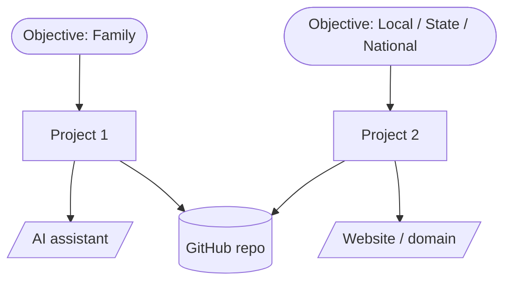

# CONTROL 00 — Master Plan

| Field | Value |
|---|---|
| Owner | _{{your name}}_ |
| Status | DRAFT |
| Created | _{{date}}_ |
| Serves | [OBJECTIVES](OBJECTIVES.md) |
| Bound by | [CONTROL 01 — Values](CONTROL-01-Values.md) |

## 1. Projects

List each project once. Every project serves at least one objective and names the framework it serves.

| # | Project | Objective level(s) | Framework | Status |
|---|---|---|---|---|
| 1 | _{{ }}_ | _{{Family / Local / State / National / Nations}}_ | _{{NBLF / NBBF / NBEF / personal}}_ | _{{Active / Quiet / Parked}}_ |
| 2 | | | | |

## 2. Resources

Every resource serves at least one project. If it serves none, drop it.

### AI assistants

| AI | Its "project" feature | Job (lane) | Projects it serves |
|---|---|---|---|
| _{{Claude / ChatGPT / Grok / Cursor / other}}_ | _{{Projects / workspace rules}}_ | _{{what it is best at for you}}_ | |

### GitHub repos

| Repo | Public or private | Project | Status |
|---|---|---|---|
| | | | |

### Domains, hosting and websites

| Domain | Registrar | Renews | Host | Website / repo | Project |
|---|---|---|---|---|---|
| | | | | | |

### Other services

| Service | Cost per month | Renews | Projects it serves |
|---|---|---|---|
| | | | |

**Never put passwords, keys or account numbers in this repo**, even if it is private.

## 3. How it all flows

Edit this chart as your plan grows. It reads top to bottom: objectives → projects → resources. Shapes, not colors, carry the meaning.

## 4. Rules

1. Every repo, AI tool, domain and service appears in Section 2 and serves a project.
2. A new resource is added here in the same week it is started.
3. Review once a month: update statuses, renewals and costs, and drop what serves nothing.

## 5. Change log

| Date | Change |
|---|---|
| _{{date}}_ | First draft |
